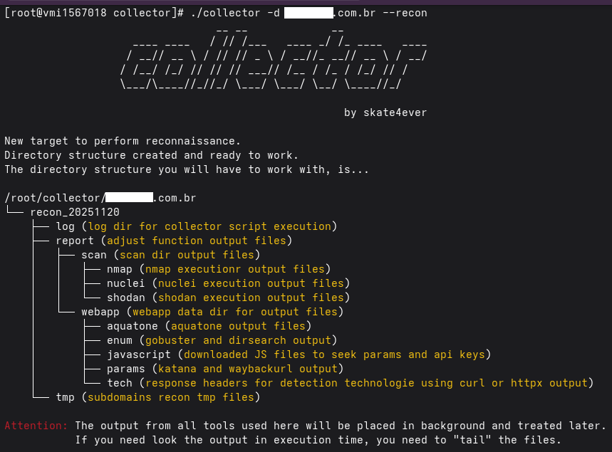
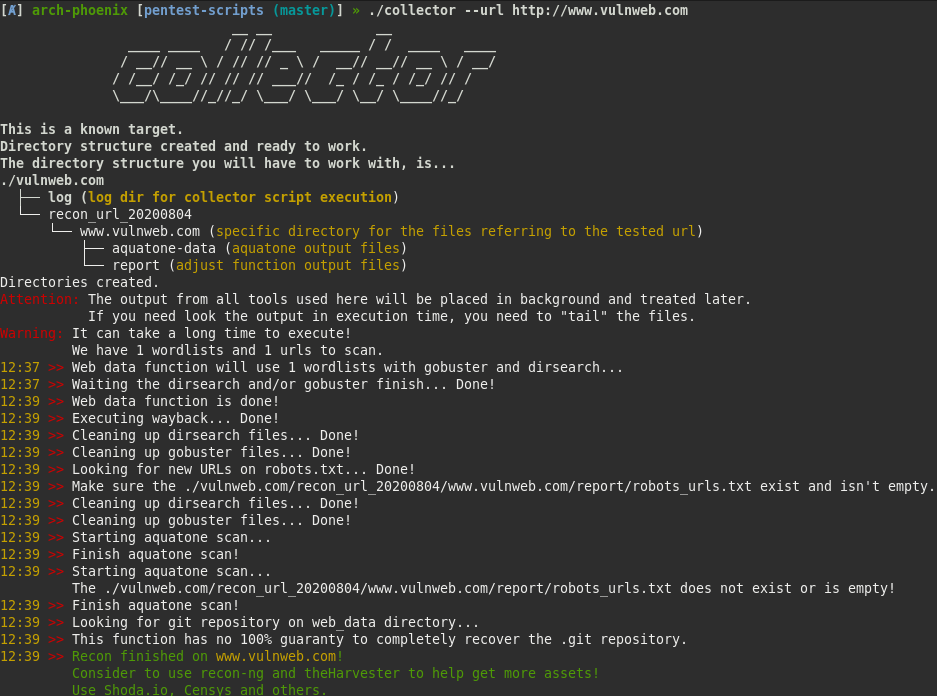

## collector

collector is a Bash script that automates reconnaissance and information gathering during penetration tests and bug bounty hunting. It runs **exclusively inside a Docker container**.

## Quick start

Build the image once (or use `collector-docker --image` for automated builds):

```bash
docker build --progress=plain -t collector:latest .
# or with collector-docker's image management subcommand (defaults to
# --progress=plain already, see BUILD_PROGRESS in the reference below)
./collector-docker --image build-only
```

Run a full recon + webapp discovery:

```bash
collector-docker -d example.com --recon --webapp-discovery --webapp-short-detection
```

Results are written to `/opt/collector/outputs/example.com/recon_YYYYMMDD/`.

## Execution methods

`collector-docker` is the only documented way to run collector — every example in this README uses it. It's a thin wrapper around `docker run` that injects the right volumes, resolves the dashboard port from `conf.d/operation.conf`, and manages the `--report-up`/`--report-down` container lifecycle for you, so you never have to hand-assemble `-v` flags or remember which port mapping matches your config. **All scripts and configuration are mounted as read-only volumes from the host** (`collector`, `functions/`, `scans/`, `sources/`, `support/runtime/`, `support/templates/alerts-notify/`, `conf.d/`), meaning code changes are instantly available without rebuilding the Docker image. The image only needs rebuilding when binaries or system packages change (Dockerfile or `check_binaries.sh` modifications).

Running collector any other way (bare `docker run`, `docker compose`) is possible — `collector` is, underneath, just a container entrypoint — but isn't covered here: those paths need you to hand-manage volumes, the dashboard port, and container naming/lifecycle yourself, exactly the bookkeeping `collector-docker` exists to avoid. Running two of those by hand with mismatched settings is also the most common source of confusion reported with the dashboard, which is why this README no longer shows them as examples.

See [Docker Volume Strategy](support/docker/VOLUME_STRATEGY.md) for detailed documentation on how volumes are mounted and replicated from host to container.

The wrapper resolves its defaults with a hybrid strategy:

- Running from a repo checkout (i.e. `conf.d/` sits next to the script), defaults point at that checkout — `git clone` and run without any sudo or filesystem prep.
- Installed to `/usr/local/bin/` (no `conf.d/` next to the script), defaults fall back to `/opt/collector/`, the layout produced by `sudo install ...`.

Install it once and use it like a native command:

```bash
sudo install -m 0755 /opt/collector/collector-docker /usr/local/bin/collector-docker
sudo mkdir -p /opt/collector/{outputs,wordlists,app-report/db,app-report/run}
sudo cp -r /opt/collector/conf.d /opt/collector/conf.d
```

Override defaults via environment variables (`<root>` is the checkout directory or `/opt/collector`, per the rule above):

| Variable | Default |
|----------|---------|
| `COLLECTOR_IMAGE` | `collector:latest` |
| `OUTPUTS_DIR` | `<root>/outputs` (mounted to `/opt/collector/outputs`) |
| `WORDLISTS_DIR` | `<root>/wordlists` (mounted to `/opt/collector/wordlists`) |
| `APP_REPORT_DB_DIR` | `<root>/app-report/db` (mounted onto itself, `/opt/collector/app-report/db`) |
| `APP_REPORT_RUN_DIR` | `<root>/app-report/run` (mounted onto itself, `/opt/collector/app-report/run`) |
| `CONF_D_DIR` | `<root>/conf.d` (mounted to `/opt/collector/conf.d`) |
| `ALERT_PROVIDER_TYPE` | `discord` (discord, slack, teams, telegram, signal) |
| `ALERT_PROVIDER_FILE` | `<root>/{type}-provider.yaml` (optional; if missing, uses template from image) |
| `APP_REPORT_HOST_ADDRESS` | overrides `app_report_host_address` from `conf.d/operation.conf` for this invocation (see below) |
| `APP_REPORT_HOST_PORT` | overrides `app_report_host_port` from `conf.d/operation.conf` for this invocation (see below) |
| `REPORT_CONTAINER_NAME` | `collector-report` |

**Every setting that changes how the dashboard is exposed lives in `conf.d/operation.conf`** — `collector-docker` reads it rather than hardcoding its own values; `127.0.0.1`/`8000` only kick in as a last-resort fallback if that file is missing or unreadable (see the precedence note below the list):

- `app_report_container_port` (default `8000`) — the port gunicorn binds to *inside* the container. `collector-docker` reads this same file to build the `-p` mapping it publishes, so changing `app_report_container_port` alone is enough: the container-internal port and the published port always agree.
- `app_report_host_address` (default `127.0.0.1`) — the address `collector-docker` publishes the dashboard on, i.e. the host-side half of `-p`, and what the "dashboard is up" message prints. **This is the one setting that controls whether another machine can reach the dashboard.** Leaving it at `127.0.0.1` means only the machine running collector can reach it. Set it to that machine's LAN/public IP, or `0.0.0.0` to publish on every interface:

  ```bash
  # conf.d/operation.conf
  app_report_host_address="0.0.0.0"
  ```

  The printed dashboard URL always uses this same value, so it stays accurate automatically — no second variable to keep in sync. Note that `app_report_container_address` in the same file is a different, container-internal setting (gunicorn's own bind address inside the container's network namespace) and does not need to change for this.
- `app_report_host_port` (default `8000`, matching `app_report_container_port`) — set only if the externally-published port needs to differ from the container's internal `app_report_container_port`.

`APP_REPORT_HOST_ADDRESS`/`APP_REPORT_HOST_PORT` environment variables exist only to override the above for a single `collector-docker` invocation without editing the config file — they always win over `conf.d/operation.conf` when set, but `conf.d/operation.conf` is where the real default lives.

Full precedence, address and port alike: (1) the environment variable, if set; (2) the matching `conf.d/operation.conf` variable; (3) if `conf.d/operation.conf` can't be found or read, `collector-docker` falls back to a hardcoded `127.0.0.1`/`8000` so it still has something to publish. `docker-compose.yaml` has the same last-resort fallback baked into its `ports:` line (`${APP_REPORT_HOST_ADDRESS:-127.0.0.1}:${APP_REPORT_CONTAINER_PORT:-8000}`), since Compose's YAML can't execute shell logic to read `conf.d/operation.conf` itself — see the comment above that line for why both sides have to be kept in sync by hand via `.env`.

Neither is published unless `--report-up` is passed — the dashboard itself never starts without it (see [Dashboard control](#dashboard-control) below), so a plain recon run doesn't publish or need the port at all. When `--report-up` is passed and the published port is already bound (by an ongoing `--report-up` session, or any other listener), the wrapper fails fast with a clear message — naming `app_report_container_port`, not a hardcoded `8000` — instead of silently booting a persistent, unreachable container.

> **Running several targets at once?** `--report-up` names a single fixed container (`REPORT_CONTAINER_NAME`, default `collector-report`) and publishes a single fixed port — it isn't meant to run more than once at a time. Recon itself has no such limit: `collector-docker -d <target> --recon` (without `--report-up`) is safe to run in parallel for as many different domains as you want (the per-target lock, anonymous container, and WAL-mode results DB all make that safe — see [Common usage patterns](#common-usage-patterns)). Bring up one shared dashboard afterward (`collector-docker --report-up`, no target) to see all of them.

## Keeping collector up to date

`collector-docker --image <subcommand>` automates pulling changes and rebuilding the Docker image **only when necessary**:

```bash
./collector-docker --image update              # git pull + conditional rebuild
./collector-docker --image pull                # git pull without building
./collector-docker --image build-only          # rebuild without pulling
./collector-docker --image update --force-build # rebuild even if no structural changes
./collector-docker --image create              # full clean rebuild: --no-cache --pull, ignores git
./collector-docker --image rm                  # remove the local image (docker rmi)
./collector-docker --image rm --force          # force removal even if a stopped container references it
```

The `update`/`pull` subcommands inspect changed files and only trigger an image rebuild when **structural files** change (Dockerfiles, `functions/check_binaries.sh`). Script-only changes are served instantly via volume mounts in `collector-docker`, so no rebuild is needed. `create` always rebuilds from scratch, ignoring both git and Docker's build cache — use it if you suspect a stale/corrupt image. `rm` (alias `remove`) just deletes the local image; run `--image create` or `--image build-only` afterwards to get it back.

Optional: install the `post-merge` git hook to auto-rebuild after every `git pull`:

```bash
git config core.hooksPath support/templates/githooks
# Now git pull automatically triggers rebuild when structural files change
```

The hook calls `collector-docker --image build-only` internally.

## Command reference

### Target selection (required — pick one)

| Flag | Description |
|------|-------------|
| `-d \| --domain <domain>` | Single target domain. |
| `-dl \| --domain-list <file>` | File with one domain per line (`#` for comments). |
| `-u \| --url <url>` | Single URL — skips infra/subdomain recon, runs webapp enum only. |
| `-dr \| --dry-run` | Run all pre-flight validations (config, locks, structure) and print a summary without executing any recon. Useful to confirm setup before a long run. |

### Recon

| Flag | Description |
|------|-------------|
| `-r \| --recon` | Passive + active subdomain discovery, DNS, infra enrichment (AS/IPs/netblocks), nmap, Shodan. Entry point for any new target. |

### Webapp discovery and vhost validation (requires `--recon` or existing `domains_alive.txt`)

| Flag | Description |
|------|-------------|
| `-wd \| --webapp-discovery` | Probes live hosts for active HTTP(S) services and builds `webapp_consolidated.txt`. Vhost discovery is **not** included unless `-vc` and/or `-vp` is also passed. |
| `-vc \| --vhost-check` | Runs `vhost_check` (curl+httpx dual-tool, STRONG/WEAK confidence) against candidates with prior evidence (`domains_without_resolution.txt`) to discover virtual hosts. STRONG hits get injected into `/etc/hosts` and scanned downstream. Requires `-wd`. Independent of `-vp` — use either or both. |
| `-vp \| --vhost-probe` | Runs `vhost_probe` (single-tool wordlist brute force, confirmed by reproducibility) against live IPs to discover virtual hosts with no prior evidence. Confirmed hits get injected into `/etc/hosts` and scanned downstream. Requires `-wd` and `-vpw`. Independent of `-vc` — use either or both. |
| `-vpw \| --vhost-probe-wordlist` | Wordlist `-vp` brute-forces vhost names from (sets `collector_vhost_probe_words`) — **required** with `-vp`, no config fallback. |
| `-wsd \| --webapp-short-detection` | Probes `webapp_http_ports` (`conf.d/functions.conf`) — ports whose protocol is fixed as plain HTTP by convention (80, 8080, ...). Use with `-wd`. |
| `-wld \| --webapp-long-detection` | Probes the full port list: `webapp_http_ports` + `webapp_tls_ports` + `webapp_multiple_ports` (`conf.d/functions.conf`) — the comprehensive, slower option. Use with `-wd`. |
| `-wcp \| --webapp-common-ports` | Probes the union of `webapp_http_ports` and `webapp_tls_ports` — the ports whose protocol is fixed by convention, HTTP or TLS. Use with `-wd`. |

### Webapp enumeration (requires existing `webapp_consolidated.txt` or combined with `--webapp-discovery`)

| Flag | Description |
|------|-------------|
| `-we \| --webapp-enum` | Directory and file brute-force with gobuster + dirsearch, robots.txt extraction, aquatone screenshots. |
| `-ww \| --webapp-wordlists <file[,file]>` | Extra wordlists for `-we`. |
| `-l \| --limit-urls <n>` | Limit enumeration to the top N URLs (used with `-d`). |

> **Wordlist paths are resolved inside the container.** `-ww` and `-s|--subdomain-brute` both pass paths straight through to a bash `[[ -s ... ]]` test that runs *inside* the container, so a host path like `~/my.txt` or `/home/leandro/lists/big.txt` won't work by itself. Stage the file under `${WORDLISTS_DIR}` on the host (default: `<root>/wordlists`, mounted at `/opt/collector/wordlists`) and pass the container path — e.g. `--webapp-wordlists /opt/collector/wordlists/big.txt`. Alternatively, override `WORDLISTS_DIR=<dir-that-contains-your-file>` when invoking `collector-docker` so the wrapper mounts that dir instead.

### Webapp crawler

| Flag | Description |
|------|-------------|
| `-wc \| --webapp-crawler` | Crawls JS files with katana and mines URL parameters with waybackurls. |

### Webapp scan

| Flag | Description |
|------|-------------|
| `-ws \| --webapp-scan` | Nuclei scan against `webapp_consolidated.txt`. |

### Subdomain brute-force (optional, used with `--recon`)

| Flag | Description |
|------|-------------|
| `-s \| --subdomain-brute <file[,file]>` | Additional wordlists for DNS brute-force via gobuster + dnssearch. |

### Scope filtering

| Flag | Description |
|------|-------------|
| `-ed \| --exclude-domain <d1,d2>` | Comma-separated subdomains to exclude from results. Used with `-d`. |
| `-el \| --exclude-domain-list <file>` | File of subdomains to exclude. Used with `-d` or `-dl`. |

### Dashboard control

The app-report dashboard **never starts unless you explicitly ask for it** with `-ru|--report-up`. It is not automatic at the end of a recon — `collector` runs as the container's PID 1, so a dashboard left running in the background would be killed the instant the recon finishes and PID 1 exits (the kernel tears down the whole PID namespace the moment its init process dies). `--report-up` keeps the container itself alive for exactly as long as the dashboard should stay up.

| Flag | Description |
|------|-------------|
| `-ru \| --report-up` | Requests the dashboard. **Alone** (no target flag): opens it read-only against the existing `outputs/` directory and exits when stopped — skips recon entirely; requires `collector-results` (in `app-report/db/`) from a previous run, and fails with a clear message if that file doesn't exist yet. **Combined** with a target flag and `--recon` (e.g. `-d target.com --recon --report-up`): runs the recon first, then brings the dashboard up and keeps the container running afterward. Either way, Ctrl-C or `--report-down` (from another shell) stops it. |
| `-rd \| --report-down` | Stop the dashboard, however it was started — alone via `--report-up`, or combined with a recon. **Must be used alone**: passing any other flag alongside it is rejected with a usage error (checked both by `collector-docker` and by `collector` itself). Sends SIGTERM, waits 5 s, then SIGKILLs if needed. Via `collector-docker` it does the equivalent `docker stop collector-report` on the host. |

Via `collector-docker`, `--report-up` also changes how the container itself runs: it's started detached (`docker run -d`, not attached) and **without** `--rm` (so it persists until stopped), with `app_report_host_address:app_report_host_port` published. Without `--report-up`, nothing changes from a plain recon: attached, `--rm`, no port published. Recon progress isn't streamed to your terminal in the combined `--report-up` case since the container runs detached — follow it with `docker logs -f collector-report` or the run's own log file under `outputs/`.

> **On stopping recon runs:** collector runs in a one-shot container, so the right way to abort an in-flight recon is `docker stop <container>` on the host. To wipe artifacts, `rm -rf` the target's directory under `outputs/`. Per-target `flock` already prevents concurrent runs against the same domain.

## Common usage patterns

Full recon + webapp discovery (short port list, no vhost):

```bash
collector-docker -d example.com --recon --webapp-discovery --webapp-short-detection
```

Full recon + webapp discovery + vhost validation (short port list, both `-vc` and `-vp`):

```bash
collector-docker -d example.com --recon --webapp-discovery --webapp-short-detection \
  --vhost-check --vhost-probe --vhost-probe-wordlist /opt/collector/support/runtime/wordlists/vhost-probe-names.txt
```

Full recon + webapp discovery + enum + scan in one shot (with vhost):

```bash
collector-docker -d example.com --recon --webapp-discovery --webapp-short-detection \
  --vhost-check --vhost-probe --vhost-probe-wordlist /opt/collector/support/runtime/wordlists/vhost-probe-names.txt \
  --webapp-enum --webapp-wordlists /opt/collector/wordlists/common.txt --webapp-scan
```

Standalone webapp enum on a previously recon'd target:

```bash
collector-docker -d example.com --webapp-enum --webapp-wordlists /opt/collector/wordlists/common.txt
```

Standalone webapp scan on a previously recon'd target:

```bash
collector-docker -d example.com --webapp-scan
```

Standalone JS crawler:

```bash
collector-docker -d example.com --webapp-crawler
```

List of targets:

```bash
collector-docker -dl /opt/collector/outputs/targets.list --recon --webapp-discovery --webapp-short-detection
```

Single URL (no subdomain/infra discovery):

```bash
collector-docker -u https://opt/collector.example.com --webapp-wordlists /opt/collector/wordlists/common.txt
```

Multiple targets in parallel — safe without `--report-up` (lock is per-domain, each run gets its own anonymous container, and the shared SQLite results DB is WAL-mode, so concurrent writes from different domains don't collide). Only bring up the dashboard once things have run — never add `--report-up` to more than one of these at a time, since it names a single fixed container and publishes a single fixed port:

```bash
collector-docker -d example-a.com --recon &
collector-docker -d example-b.com --recon &
collector-docker -d example-c.com --recon &
wait
collector-docker --report-up   # one shared dashboard, shows every domain above once it's ingested
```

Pre-flight check (dry run) — validates config and parameters without running anything:

```bash
collector-docker -d example.com --recon --webapp-discovery --webapp-short-detection --dry-run
```

## Unattended execution

Drop-in scheduling files are in `support/templates/`:

- `support/templates/cron/collector` — daily light recon + weekly heavy run via cron (`/etc/cron.d/collector`)
- `support/templates/systemd/collector@` — same cadence as systemd template units (`collector@<domain>.timer`)
- `support/templates/alerts-notify/` — multi-provider alert configuration templates for [notify](https://github.com/projectdiscovery/notify):
  - **Discord** — `discord-provider.yaml`
  - **Slack** — `slack-provider.yaml`
  - **Microsoft Teams** — `teams-provider.yaml`
  - **Telegram** — `telegram-provider.yaml`
  - **Signal** — `signal-provider.yaml`
  
  Templates are baked into the Docker image at `/opt/collector/support/templates/alerts-notify/`. To use a custom provider:
  1. Copy the template: `cp support/templates/alerts-notify/{provider}-provider.yaml ./{provider}-provider.yaml`
  2. Fill in webhook URLs or credentials
  3. Configure in `conf.d/functions.conf`: `notify_config="/opt/collector/support/templates/alerts-notify/{provider}-provider.yaml"`
  4. Run: `collector-docker -d example.com --recon`
  
  Or override via environment: `ALERT_PROVIDER_TYPE=slack ALERT_PROVIDER_FILE=./slack-provider.yaml collector-docker ...`
  
  See `support/templates/alerts-notify/README.md` for detailed setup guides for each provider.

Both use `collector-docker` — each run fires an ephemeral container. Results persist via the `/opt/collector/outputs` volume. Per-target `flock` prevents overlapping runs for the same domain when triggered by cron or timers.

## APIs and tools used

**Subdomain sources:** alienvault, builtwith, certspotter, commoncrawl, crt.sh, dnsdumpster, hackertarget, rapiddns, securitytrails, shodan, virustotal, webarchive, whoisxmlapi

**Recon tools:** amass, dnssearch, gobuster, subfinder, tlsx, waybackurls

**Infrastructure:** nmap, shodan

**Webapp discovery:** httpx, chromium

**Webapp enumeration:** dirsearch, ffuf, gobuster, git-dumper

**Webapp crawler:** katana, waybackurls (sitemap.xml expansion built in)

**Webapp scan:** nuclei

**Screenshots:** aquatone

**Email recon:** Hunter.io, IntelX (phonebook target=2), Lampyre, Snov.io (API-based) + page/JS crawl of `webapp_consolidated.txt`

**Reporting:** sqlite3, Flask, gunicorn, HTMX

## Main features

- Per-run dated folder (`recon_YYYYMMDD`) with logs, tmp, and structured report tree
- Subdomain discovery via passive sources + active DNS bruteforce
- Infrastructure enrichment: AS / IPv4 / IPv6 / netblocks / nmap / Shodan
- vhost discovery, two independent opt-ins: `-vc|--vhost-check` runs `vhost_check` (parallel curl + httpx, STRONG vs. WEAK confidence) against candidates with prior evidence; `-vp|--vhost-probe` (requires `-vpw|--vhost-probe-wordlist`) runs `vhost_probe` (single-tool wordlist brute force, with reproducibility confirmation) against a generic wordlist. Use either or both — both feed the same automatic `/etc/hosts` injection inside the container once confirmed, so all tools resolve vhosts transparently — whether or not the vhost also has public DNS. `vhost_probe` has an optional `ffuf`-backed mode for orders-of-magnitude faster probing (set `vhost_use_ffuf=yes` in `conf.d/functions.conf`)
- `-dr|--dry-run` pre-flight validation mode — confirm config and parameters before a long run
- Per-artifact diff vs. previous run — only deltas pushed to notify channel
- Email harvesting from APIs + page/JS crawl filtered to the target domain
- JS scraping and parameter mining with sink classification (SQLi/XSS/SSRF/XXE/CMD/...)
- Single LLM prompt bundle per run: `llm-prompt.txt` — all artifacts included, ready to paste into any LLM for follow-up analysis
- SQLite ingestion: each run upserted into `collector-results` (idempotent, WAL, FK-protected)
- Flask + HTMX read-only web UI at `http://127.0.0.1:8000`, on-demand via `-ru|--report-up` (never automatic — see [Dashboard control](#dashboard-control))
- Cloudflare quick-tunnel (opt-in via `cloudflare_tunnel="yes"` in `conf.d/operation.conf`) for remote dashboard access, only meaningful when `--report-up` is combined with a recon
- Per-target flock so concurrent runs for the same domain abort instead of corrupting state

## Output layout

```
<domain>/
└── recon_YYYYMMDD/
    ├── log/recon_YYYYMMDD.log
    ├── tmp/                                       intermediate files
    └── report/
        ├── <domain>_history.csv                   per-run trend log
        ├── domains_found.txt                      all discovered subdomains
        ├── domains_diff.txt                       delta vs. previous run
        ├── domains_alive.txt                      subdomains that resolve
        ├── domains_without_resolution.txt         candidates for vhost probing
        ├── domains_excluded.txt
        ├── domains_aliases.txt
        ├── domains_thirdpart.txt
        ├── domains_infrastructure.txt
        ├── domains_internal_ipv4.txt
        ├── domains_external_ipv4.txt
        ├── domains_external_ipv6.txt
        ├── zone_transfer.txt
        ├── infra_as.txt
        ├── infra_ipv4.txt / infra_ipv4_diff.txt
        ├── infra_ipv6.txt / infra_blocks.txt
        ├── webapp_consolidated.txt                all live HTTP(S) URLs (DNS + validated vhosts)
        ├── webapp_consolidated_diff.txt
        ├── etc_hosts_file.txt                     vhost→IP map (ip<TAB>hostname) injected into /etc/hosts — vhost_check STRONG + confirmed vhost_probe hits, combined
        ├── vhost_subdomains_strong.txt            STRONG vhost_check hits (curl + httpx both disagree with baseline)
        ├── vhost_subdomains_weak.txt              WEAK vhost_check hits (only one of curl/httpx disagreed) — manual review only, never auto-injected
        ├── vhost_subdomains_diff.txt              STRONG hits new since the previous run (drives the notify channel)
        ├── vhost_probe_hits.txt                   confirmed vhost_probe hits, same layout as vhost_subdomains_*.txt (scheme://host<TAB>ip:port<TAB>Size<TAB>Hash<TAB>tag; tag is always CONFIRMED) — merged into etc_hosts_file.txt too, same bar as STRONG
        ├── email_recon.txt / email_recon_diff.txt
        ├── robots_urls.txt
        ├── sitemap_urls.txt                       URLs harvested from sitemap.xml (recursive sitemapindex)
        ├── webapp_js_secrets.txt                  hardcoded keys/tokens/JWTs in JS
        ├── webapp_js_params.txt                   param names + DOM sinks (SQLi/XSS/SSRF/...)
        ├── llm-prompt.txt                         LLM bundle: all artifacts
        ├── scan/
        │   ├── nmap/nmap_scan.txt
        │   ├── nuclei/nuclei_scan.result
        │   ├── nuclei/nuclei_scan_diff.txt
        │   ├── nuclei/nuclei_web_fuzzing.result
        │   └── shodan/shodan_scan.txt
        └── webapp/
            ├── aquatone/                          screenshots
            ├── enum/                              gobuster + dirsearch output
            ├── javascript/                        downloaded JS files
            ├── params/                            katana + waybackurls output
            └── tech/                              response headers / fingerprinting
```

## Results database (SQLite)

After every run, `db_usage()` upserts the latest row into `app-report/db/collector-results` (path resolved from `collector_db` in `conf.d/operation.conf`; lives on its own volume — `APP_REPORT_DB_DIR` — independent of `outputs/`, since it isn't per-run recon output). Schema: `targets(domain PK)` + `recon_runs(domain, run_id, ...)` with composite PK, `latest_run` view. Ingestion is idempotent — re-importing the same `run_id` only writes on payload change.

```bash
# Access from outside the container
sqlite3 /opt/collector/app-report/db/collector-results \
  "SELECT domain, run_date, findings_critical, findings_high, js_secrets FROM latest_run ORDER BY findings_critical DESC;"

sqlite3 /opt/collector/app-report/db/collector-results \
  "SELECT run_date, subdomains, webapp_consolidated, findings_critical FROM recon_runs WHERE domain='example.com' ORDER BY run_date DESC LIMIT 10;"
```

## Web UI

Flask + HTMX read-only dashboard at `http://127.0.0.1:8000` — **on-demand only**, via `-ru|--report-up` (see [Dashboard control](#dashboard-control) for the full flag reference). It never starts automatically: a plain recon doesn't publish the port or touch the dashboard at all. Add `--report-up` to any recon invocation to bring it up afterward, in the same container — `collector-docker` figures out the port mapping for you (derived from `conf.d/operation.conf`, see below):

```bash
collector-docker -d example.com --recon --webapp-discovery --webapp-short-detection --report-up
```

Reopening the dashboard from an earlier scan (no new recon):

```bash
collector-docker --report-up           # detached, port published, persists until stopped
collector-docker --report-down         # stop from another shell
```

Or bring it up at the end of a fresh recon, same container:

```bash
collector-docker -d example.com --recon --report-up
collector-docker --report-down         # stop when done
```

`--report-up` names its container `collector-report` (override with `REPORT_CONTAINER_NAME=<name>`) and refuses to start when one is already running. Passed alone, it requires `collector-results` to exist in the `app-report/db/` directory — otherwise it aborts with a clear message rather than serving an empty dashboard.

Or set `cloudflare_tunnel="yes"` in `conf.d/operation.conf` for an ephemeral `https://*.trycloudflare.com` URL (only meaningful when `--report-up` is combined with a recon, since that's the only background-dashboard case; `--report-up` alone doesn't publish a tunnel).

## Screenshots




## Thanks

[Alfredo Casanova](https://github.com/atcasanova) — bash code corrections.
[Caue Bici](https://github.com/caueobici) — code review and Python help.
[Enderson Maia](https://github.com/endersonmaia) — Dockerfile and shellcheck.
[Henrique Galdino](https://github.com/Achilles0x0) — curl options.
[Icaro Torres](https://github.com/icarot) — diff-based execution idea.
[Manoel Abreu](https://github.com/manoelt) — git-dumper integration idea.
[Rener aka gr1nch](https://github.com/renergr1nch/splitter) — splitter tool.
[Ulisses Alves](https://github.com/ualvesdias) — code review and Python help.

**Warning:** collector generates a substantial amount of traffic. Use only against targets you have explicit authorization to test.
